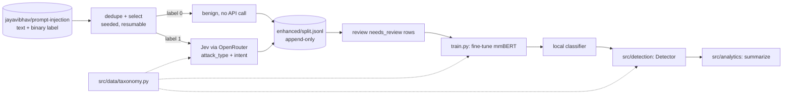

# Architecture

_Last updated: 2026-11-21_

havelAI has a small, dependency-free **library** and a separate **model workspace**. The attack taxonomy is the contract between them.

## Layout

```
src/                       published as `havelai`
├── analytics/             summarize detections (counts per attack type, injection rate)
├── data/                  taxonomy.py: attack classes, labeler criteria, label ids
├── detection/             Detection result, Detector protocol, detectors
└── tests/
model/                     not shipped
├── train/
│   ├── data/              raw + enhanced JSONL (gitignored)
│   ├── enhance_pipeline.py
│   └── train.py           (not implemented yet)
├── architecture.py        mmBERT classifier builder
└── tests/
```

`model/` imports `src.data.taxonomy`; `src/` never imports `model/`. The wheel contains `src/` only, renamed to `havelai` by Hatch.

## Data flow



## Enhancement pipeline

1. **Load** both splits with `datasets` and drop rows with no text or a label outside {0, 1}.
2. **Dedupe** by `sha1(normalized text)`. Identical texts are collapsed; texts that appear with both labels are excluded and counted.
3. **Select** with a seeded shuffle over ids. `--limit N` takes the first N, so raising the limit later extends the same selection.
4. **Skip** ids already in the output file (resume). A line cut off by a crash is repaired.
5. **Label**: label 0 → `benign` in code. Label 1 → one request to Jev with two `choice` questions, `attack_type` (the training target) and `intent` (extra column). Retries with backoff on 429/5xx; 401/402/403 abort the run; other 4xx are logged per row and retried next run.
6. **Write** one JSONL line per row, flushed: `id, split, text, label, attack_type, attack_type_confidence, attack_type_probs, intent, intent_confidence, needs_review, labeler_model, cost_usd, labeled_at`.
7. **Budget**: `usage.cost` is summed; `--max-cost` stops the run gracefully.

Jev is a decision model, not a text generator: it returns a label with probabilities and no explanation. It has no abstain option, so the taxonomy includes `other_injection`, and low-confidence rows are flagged for review. Probabilities are calibrated only on average, so the review threshold must be tuned on a hand-labeled sample.

## Library

`Detection(text, attack_type, score)` is the result of scanning one text; `Detector` is the protocol every detector implements (`detect(text) -> Detection`). `analytics.summarize` aggregates detections. The mmBERT detector will be added in `src/detection/` once a model is trained.
