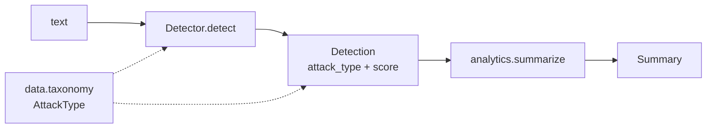

# Architecture

_Last updated: 2026-11-21_

This file describes the **Python library** (`src/`, installed as `havelai`). The model workspace (`model/`) has its own documents in `docs/`; a short overview is at the end.

The library is stdlib-only at runtime. It defines what a detection is, which attack classes exist, and how results are aggregated. Detectors plug in behind a small protocol.

## Layout

```
src/                       published as `havelai`
├── __init__.py            public exports: AttackType, ATTACK_CRITERIA, Detection, Detector
├── analytics/             summarize detections (counts per attack type, injection rate)
├── data/                  taxonomy.py: attack classes, labeler criteria, label ids
├── detection/             Detection result, Detector protocol, detectors
├── py.typed
└── tests/                 not shipped
```

## Modules

| Module | Contents | Depends on |
|---|---|---|
| `data.taxonomy` | `AttackType` (StrEnum), `ATTACK_CRITERIA`, `INTENT_CRITERIA`, `LABELS`, `LABEL2ID`, `ID2LABEL`. The only place labels are defined. | nothing |
| `detection.base` | `Detection(text, attack_type, score)` (frozen dataclass, `is_injection` property) and the `Detector` protocol (`detect(text) -> Detection`). | `data` |
| `analytics.summary` | `summarize(detections) -> Summary(total, injections, by_attack_type, injection_rate)`. | `detection` |

Dependencies point one way: `analytics → detection → data`. Nothing in `src/` imports `model/`.



`score` is the detector's confidence in `attack_type`, from 0 to 1. `Detection.is_injection` is true for every attack type except `benign`.

## Adding a detector

Implement `detect(self, text: str) -> Detection` in a class under `src/detection/`. The `Detector` protocol is `runtime_checkable`, so `isinstance(obj, Detector)` works without inheritance. Detectors that need heavy dependencies (for example a transformer model) must import them lazily or sit behind an optional extra, so that importing `havelai` stays dependency-free. No concrete detector exists yet.

## Packaging and import names

The folder is `src/`; the installed package is `havelai`. Hatch maps one to the other when the wheel is built (`[tool.hatch.build.targets.wheel.sources]` in `pyproject.toml`).

- Library code uses **relative imports** (`from ..data.taxonomy import AttackType`), because an absolute `from src...` would fail in the wheel.
- Tests and `model/` import `src.*`. Hatch cannot make an editable install with a renamed prefix, so `dev-mode-dirs = ["."]` puts the repo root on `sys.path` in development.
- Verified by building a wheel and installing it (`import havelai.detection` works, `import src` does not) with `pip install -e .`, and with `uv sync` (the dev environment exposes `src`, not `havelai`).

## Model workspace (overview)

`model/` is not shipped. It turns the public dataset into a trained classifier that a future detector will load:

1. [`enhance_pipeline.py`](docs/ENHANCEMENT_PIPELINE.md) adds an attack type to the binary labels of `jayavibhav/prompt-injection`, using the Jev decision model on OpenRouter.
2. [`train.py`](docs/TRAINING.md) fine-tunes an mmBERT classifier on the result; `metrics.py` computes, tracks and plots its metrics.
3. [`architecture.py`](docs/MODEL_ARCHITECTURE.md) defines the model: mmBERT-small with a binary and an attack-type head (defined and tested; training it, vocabulary pruning and the int8 export are not built yet).

`model/` imports `src.data.taxonomy`, so the library and the model always agree on the class list. Details live in `docs/`: [`TAXONOMY.md`](docs/TAXONOMY.md), [`ENHANCEMENT_PIPELINE.md`](docs/ENHANCEMENT_PIPELINE.md), [`TRAINING.md`](docs/TRAINING.md), [`MODEL_ARCHITECTURE.md`](docs/MODEL_ARCHITECTURE.md).
