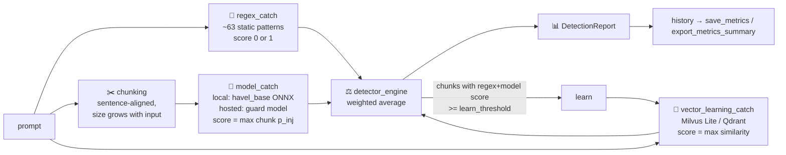
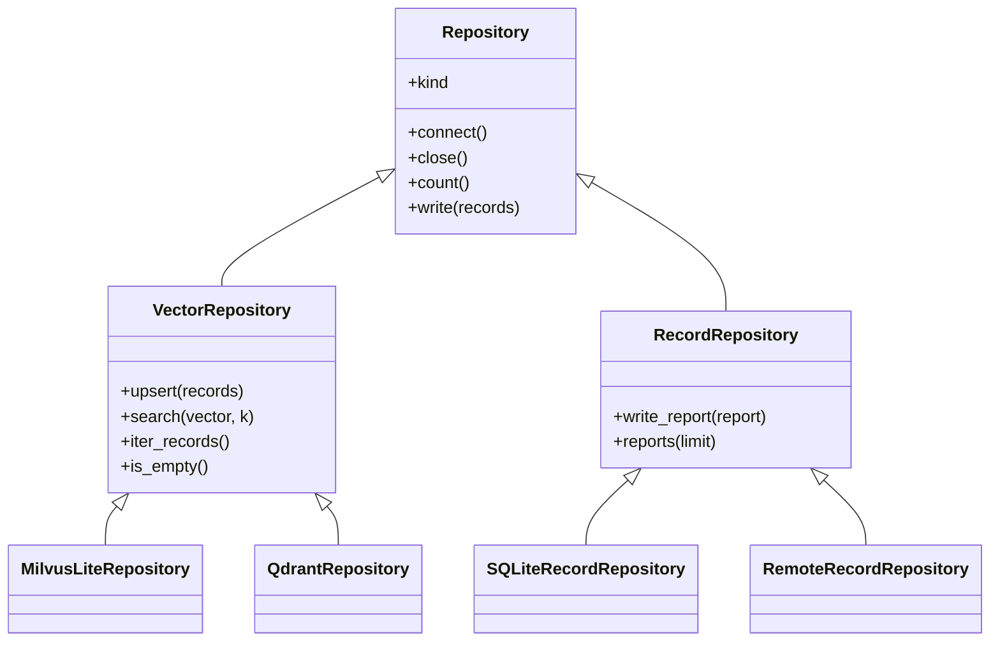

# Architecture

_Last updated: 2026-11-26_

This file describes the **Python library** (`src/`, installed as `havelai`). The model workspace (`model/`) has its own documents in `model/docs/`; a short overview is at the end.

The **core** of the library (taxonomy, `Detection`, analytics types, the regex layer, the SQLite analytics store) is stdlib-only. The **detection services** that need heavy dependencies sit behind two optional extras:

| Install | Import | Runs |
|---|---|---|
| `pip install havelai` | `import havelai` | taxonomy, result types, summaries |
| `pip install havelai[local]` | `from havelai.local import Havel` | regex + **havel_base** (ONNX, on this CPU) + **Milvus Lite** (one local file) |
| `pip install havelai[hosted]` | `from havelai.hosted import Havel` | regex + a **guard model at a provider** (OpenRouter by default) + **Qdrant** |

## Layout

```
src/                         published as `havelai`
├── __init__.py              AttackType, ATTACK_CRITERIA, Detection, Detector
├── local.py / hosted.py     public entry points: Havel, Config, VectorConfig, ModelConfig, DetectionReport
├── analytics/
│   ├── summary.py           summarize(detections)
│   ├── report.py            DetectionReport: everything one detect() call measured
│   └── export.py            export_metrics_summary: Markdown + matplotlib plots
├── data/
│   ├── taxonomy.py          the only place labels are defined
│   └── regex_patterns.py    static regex patterns, keyed by AttackType
├── detection/base.py        Detection, Detector protocol
├── repositories/            every data write goes through here
│   ├── base.py              Repository (ABC) → VectorRepository, RecordRepository
│   ├── milvus_lite.py       vector store, local .db file
│   ├── qdrant.py            vector store, hosted (or in-memory)
│   ├── sqlite.py            analytics store, local file (SCHEMA.sql)
│   ├── remote_http.py       analytics store, hosted ingest URL
│   ├── schema.py            SCHEMA.sql, shipped with the package
│   └── factory.py           pick a connector by name
├── services/
│   ├── common/              config, .env reader, chunking, ingest, embedder, Layer protocol, engine
│   ├── local/               regex_catch, model_catch, vector_learning_catch, detector_engine
│   └── hosted/              same four files, hosted backends
└── tests/                   not shipped
```

## Detection flow



### The three layers

Each layer implements `Layer.score(text) -> LayerResult(layer, score, fired, attack_type, seconds, detail)` (`services/common/layer.py`).

| Layer | Local | Hosted | Score | Fires when |
|---|---|---|---|---|
| `regex_catch` | `re.search` over static patterns (`data/regex_patterns.py`) | same code | 1 if any pattern matches, else 0 | any match |
| `model_catch` | havel_base, ONNX int8 (or fp32), downloaded from Hugging Face on first use, onnxruntime + tokenizers | guard model over an OpenAI-compatible endpoint: `openai/gpt-oss-safeguard-20b` (default, taxonomy policy, JSON answer) or Llama Guard | local: highest `p_injection` over the chunks; hosted: from the verdict and its confidence | score ≥ 0.5 |
| `vector_learning_catch` | Milvus Lite file + fastembed | Qdrant + fastembed | highest cosine similarity to a stored attack text (clipped to 0..1) | similarity ≥ `catch_threshold` (0.8) |

**Chunking (local model layer).** The prompt is split into sentences, and the sentences are packed into chunks of at most `clamp(64, 512, 32·⌈√tokens⌉)` tokens (`services/common/chunking.py`). Short prompts stay whole. Long documents get chunks of up to 512 tokens, the length the model was trained on. Each chunk is scored on its own, so one injected sentence is not diluted by the benign text around it. The hosted layer sends the whole prompt in one call, since guard models have long contexts and one call per chunk would multiply cost.

> 🧪 **A data-augmentation training batch is coming.** The current model was trained on mostly short, standalone prompts. The next batch will insert prompt injections into benign text in different ways (start, middle or end of a document; inside emails, code, markdown or tool output; split across sentences). That teaches the model to find an injection inside a chunk, which is what this layer asks of it. See [`model/docs/ARCHITECTURE.md`](model/docs/ARCHITECTURE.md).

**Vector layer, three phases.**
1. `initialize(path, column, table=None)`: load known attack texts from csv/tsv, parquet or SQLite (`services/common/ingest.py`). Raises `VectorIngestError` if the column is missing or not text: a numeric csv column, a non-string parquet type, or a SQLite column without text affinity or with non-TEXT values.
2. `learn(chunks, scores)`: runs automatically at the end of every `detect()` call. The engine passes each chunk with `w_regex·regex + w_model·chunk_p_inj`, the two weights rescaled to sum to 1. Chunks at or above `learn_threshold` (0.7) are embedded and upserted straight into the active store (`VectorConfig.db_path` for Milvus Lite, or Qdrant) with their attack type — no manual `save()` needed. Off with `VectorConfig(learning=False)`.
3. `detect(text)`: the highest similarity and the top 10 stored texts.

### Weights (`services/common/config.py`)

`final = Σ weight_i × score_i`; `is_injection = final ≥ detect_threshold` (0.5).

| Situation | regex | model | vector |
|---|---|---|---|
| default, vector layer off or its store empty | 0.10 | 0.90 | 0 |
| default, vector store has vectors | 0.10 | 0.65 | 0.25 |
| a layer switched off | its weight is dropped, the rest are rescaled to sum to 1 | | |
| `detector_scoring={...}` given | used as is, after checks | | |

Checks on explicit weights (`ConfigError`): only the three keys, each value in 0..1, a switched-off layer must weigh 0, a switched-on layer must weigh more than 0, and the sum must be 1 (±1e-6).

The attack type of an injection comes from the first layer that fired, in this order: model, regex, vector. If none fired, it is `other_injection`.

## Public API

```python
from havelai.local import Havel

h = Havel()
h.Config(
    regex_catcher=True,
    model_catcher=True,
    vector_catcher=False,
    detector_scoring={"regex_contribution": 0.1, "model_contribution": 0.9, "vector_contribution": 0.0},
).VectorConfig(
    catch_threshold=0.8,
    learn_threshold=0.7,
    db_path="havel_vectors.db",  # local Milvus Lite file; detect() writes learned chunks here directly
    provider_url=None,           # Qdrant for hosted mode / save("hosted"); default QDRANT_URL in .env
    provider_api_key=None,       # default QDRANT_API_KEY
).ModelConfig()                  # local default: havel_base int8, downloaded on first use (logged)

report = h.detect(prompt)                # DetectionReport (auto-learns chunks >= learn_threshold)
h.initialize_vectors("attacks.csv", column="text")
h.save("vectors_backup.db")              # optional: copy the vector store to another Milvus Lite file
h.save("hosted")                         # optional: push it to Qdrant (url/api_key from VectorConfig or .env)
h.save_metrics("metrics.sqlite")         # history → SQLite (SCHEMA.sql); "hosted" → HAVEL_ANALYTICS_URL
h.export_metrics_summary("summary.md")   # Markdown + PNG plots in summary_plots/
```

`Config`, `VectorConfig` and `ModelConfig` return the `Havel`, so calls chain. Snake-case aliases: `configure`, `configure_vector`, `configure_model`. Layers are built on first use, so `Havel()` downloads nothing.

## Repositories: the data-write layer

All writes go through `src/repositories/`. Layers and engines only see the abstract types; `factory.py` picks the connector.



- Vector records are keyed by `sha256(text)[:32]`, so the same text is stored once. Qdrant uses the UUID form of that id.
- The record stores write the tables in [`SCHEMA.sql`](SCHEMA.sql): `detections`, `layer_scores`, `vector_hits`, `learned_vectors`. The schema works on SQLite and PostgreSQL. `src/repositories/schema.py` ships it in the wheel, and a test keeps the two identical.
- `remote_http` contract: `POST {url}/detections` (a report as JSON), `GET {url}/detections?limit=N`, `GET {url}/detections/count`, with `Authorization: Bearer <HAVEL_ANALYTICS_API_KEY>`.

## Analytics: `DetectionReport`

One per `detect()` call (`analytics/report.py`), JSON-ready with `to_dict()` and `from_dict()`. Fields:

- **Per layer:** score, weight, contribution, fired, attack type, time.
- **Verdict:** final score, is_injection, attack type, `detected_by`.
- **Thresholds:** detect, vector catch and vector learn.
- **Prompt and chunking:** prompt tokens, target chunk size, chunk count, tokens and index of the detecting chunk.
- **Vector layer:** vectors in the store at detection time, max similarity, top 10 texts, chunks learned, db type, embedder model and dimensions.
- **Versions and timing:** mode, library version, local model version (`None` when hosted), hosted model and endpoint (`None` when local), detection time, id, timestamp.

The prompt itself is never stored. `report.to_detection()` gives a plain `Detection`, so `analytics.summary.summarize` works on reports.

## Packaging and import names

The folder is `src/`; the installed package is `havelai`. Hatch maps one to the other when the wheel is built (`[tool.hatch.build.targets.wheel.sources]` in `pyproject.toml`).

- Library code uses **relative imports** (`from ..data.taxonomy import AttackType`), because an absolute `from src...` would fail in the wheel.
- Tests and `model/` import `src.*`. Hatch cannot make an editable install with a renamed prefix, so `dev-mode-dirs = ["."]` puts the repo root on `sys.path` in development.
- Heavy dependencies are imported lazily inside the layer or connector that needs them, so `import havelai` and `import havelai.local` work without the extras. The error appears only when a layer is first used.

## Model workspace (overview)

`model/` is not shipped. It turns the public dataset into the classifier that `model_catch` downloads:

1. [`enhance_pipeline.py`](model/docs/ENHANCEMENT_PIPELINE.md) adds an attack type to the binary labels of `jayavibhav/prompt-injection`, using the Jev decision model on OpenRouter.
2. [`train.py`](model/docs/TRAINING.md) fine-tunes an mmBERT classifier on the result; `metrics.py` computes, tracks and plots its metrics.
3. [`architecture.py`](model/docs/ARCHITECTURE.md) defines the model. Trained and published today: **`havel_base`**, a single-head mmBERT-small (results in [`model/docs/METRICS.md`](model/docs/METRICS.md)). Planned: two heads, 32k vocabulary, int8.
4. [`export/hf_publish.py`](model/docs/TRAINING.md#export-and-publishing) exports it to ONNX fp32 and int8, verifies both, and publishes `Gigadelux/havel_base`.

> 🧪 **Next: a data-augmentation training batch**, in which prompt injections are inserted into benign text in different ways, so the model learns to find them inside the chunks the library scores.

`model/` imports `src.data.taxonomy`, so the library and the model always agree on the class list. Details: [`docs/TAXONOMY.md`](docs/TAXONOMY.md), and in `model/docs/`: [`ARCHITECTURE.md`](model/docs/ARCHITECTURE.md), [`METRICS.md`](model/docs/METRICS.md), [`TRAINING.md`](model/docs/TRAINING.md), [`ENHANCEMENT_PIPELINE.md`](model/docs/ENHANCEMENT_PIPELINE.md).
