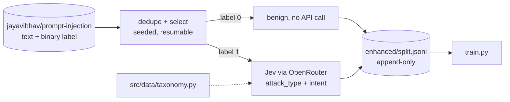

# Enhancement pipeline

_Last updated: 2026-11-21_

`model/train/enhance_pipeline.py` adds an **attack type** to the binary dataset [`jayavibhav/prompt-injection`](https://huggingface.co/datasets/jayavibhav/prompt-injection) (`text`, `label` 0/1; train 261,738 and test 65,416 rows; no license shown on the card). The classes are defined in [`src/data/taxonomy.py`](../src/data/taxonomy.py) and explained in [`TAXONOMY.md`](TAXONOMY.md).



## Steps

1. **Load** both splits with `datasets` and drop rows with no text or a label outside {0, 1}.
2. **Dedupe** by `sha1(normalized text)`. Identical texts are collapsed; texts that appear with both labels are excluded and counted.
3. **Select** with a seeded shuffle over ids. `--limit N` takes the first N, so raising the limit later extends the same selection.
4. **Skip** ids already in the output file (resume). A line cut off by a crash is repaired.
5. **Label**: label 0 → `benign` in code. Label 1 → one request to Jev with two `choice` questions, `attack_type` (the training target) and `intent` (extra column). Retries with backoff on 429/5xx; 401/402/403 abort the run; other 4xx are logged per row and retried next run.
6. **Write** one JSONL line per row, flushed: `id, split, text, label, attack_type, attack_type_confidence, attack_type_probs, intent, intent_confidence, needs_review, labeler_model, cost_usd, labeled_at`.
7. **Budget**: `usage.cost` is summed; `--max-cost` stops the run gracefully.

## The labeler (Jev)

`typesafe/jev-1.14` on OpenRouter, called with `POST /api/alpha/decisions` (alpha endpoint: the shape may change). It is a decision model, not a text generator: it returns a label with probabilities and no explanation. Price at the time of writing: $0.042 per million input tokens, output free. It has no abstain option, so the taxonomy includes `other_injection`, and low-confidence rows are flagged for review. Probabilities are calibrated only on average, so the review threshold must be tuned on a hand-labeled sample.

- Pin the model version; never use `~typesafe/jev-latest`. Each row stores the dated snapshot that labeled it.
- Question ids are not shown to the model, so all meaning is in the instructions and criteria.
- `needs_review` marks refusals, `other_injection`, and confidence below `--min-confidence` (0.6, a placeholder).

## Commands

```bash
uv run python -m model.train.enhance_pipeline --split train --limit 200 --dry-run   # print a request, call nothing
uv run python -m model.train.enhance_pipeline --split train --limit 200             # small paid trial
uv run python -m model.train.enhance_pipeline --split all --max-cost 5              # full run with a budget
uv run python -m model.train.enhance_pipeline --stats                               # class counts, review rate, cost
```

Only label-1 rows are sent to the API. Positive rows leave your machine (OpenRouter, then TypeSafe): do not use private text. Check the measured cost of the 200-row trial before a full run.

## Known limits

- A label-0 row that is really an attack is not caught: benign rows are never sent to the labeler.
- The dataset card does not say which label means injection; 1 = injection is inferred from example rows.
- Labels are model-generated. Hand-label a sample before trusting them.
