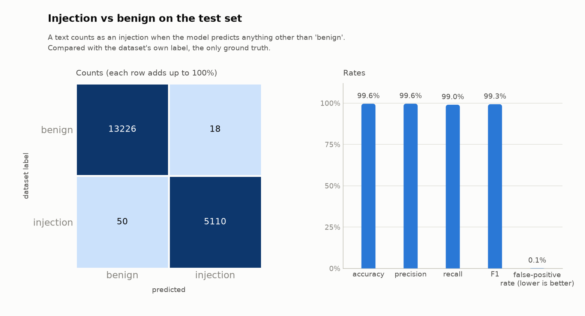
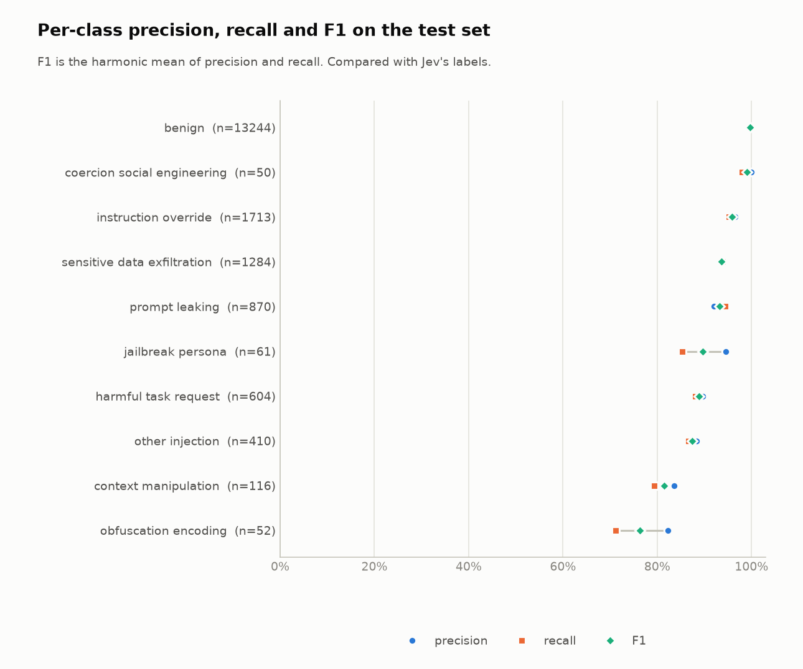
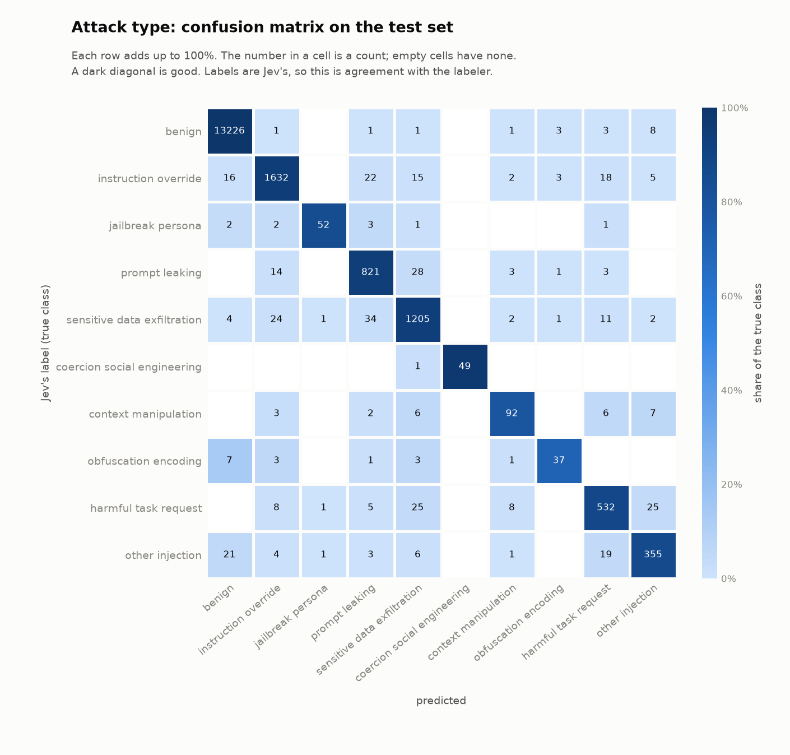
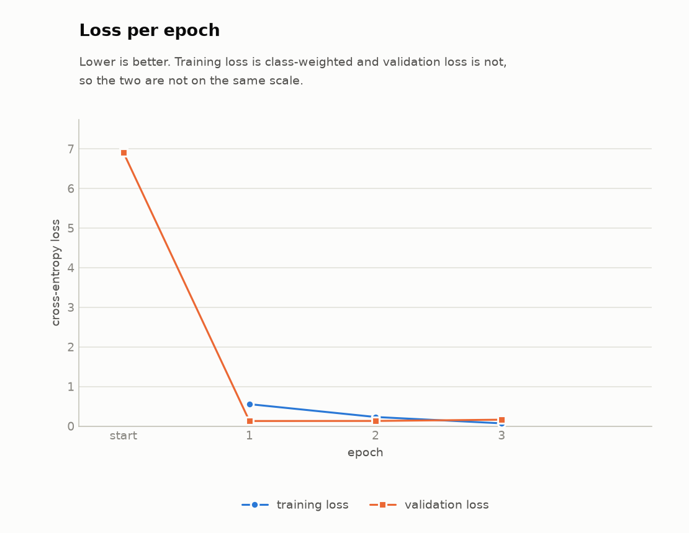
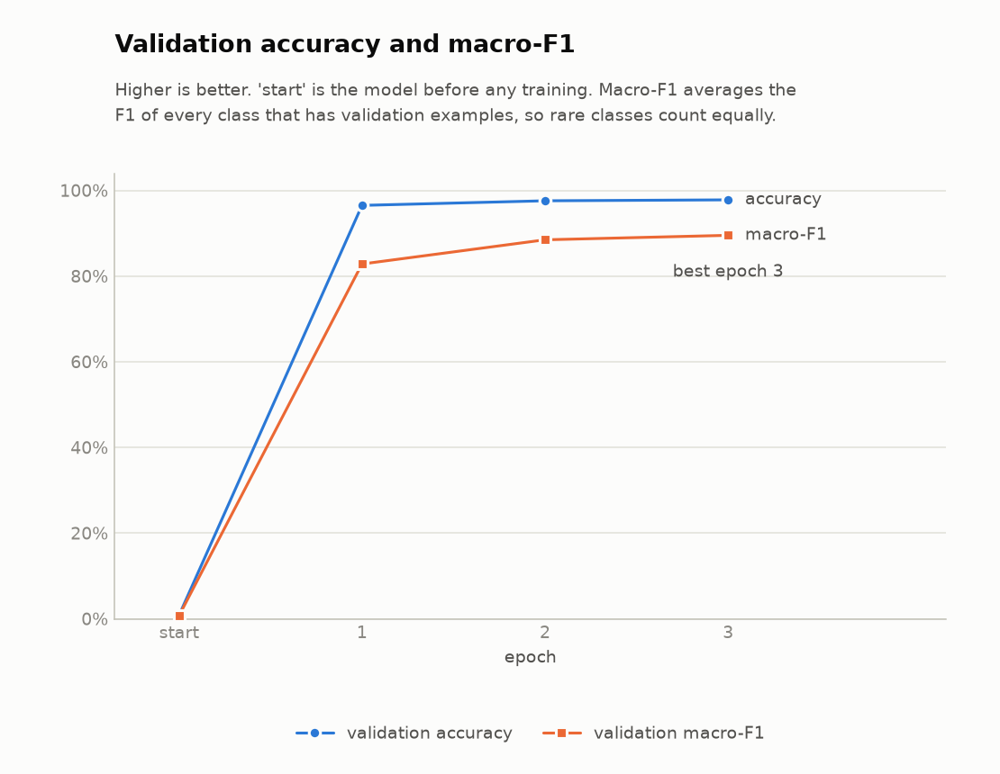
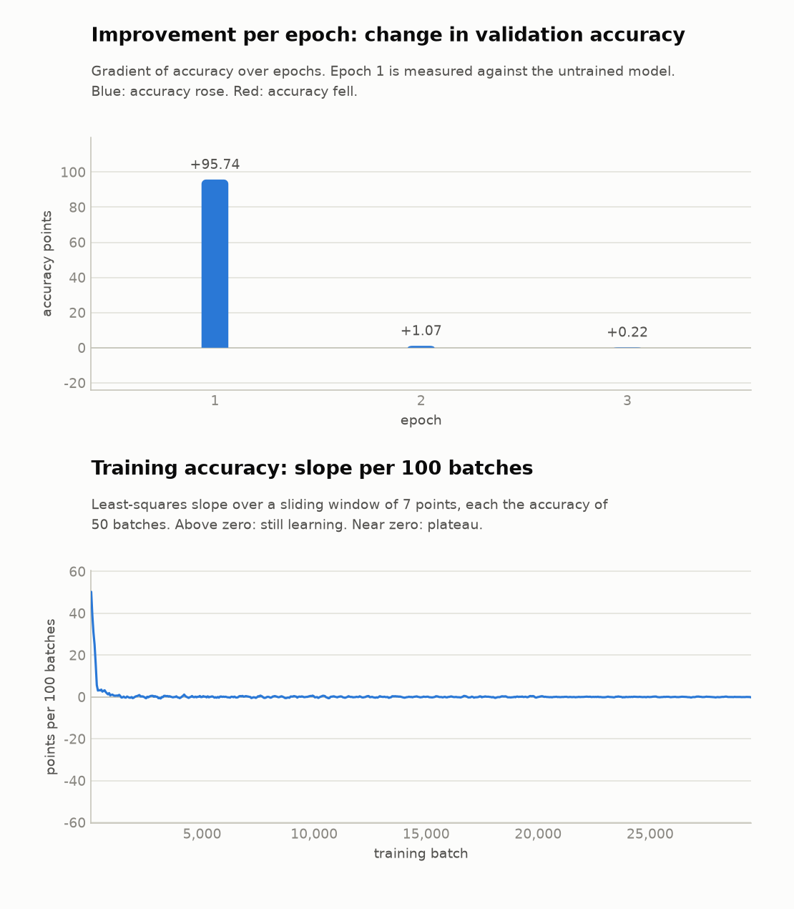

# Metrics: `havel_base` v0.1

_Last updated: 2026-11-26_

Measured results of the first full training run, **`mmBERT-small-runpod-20261125T190715Z`** (created 2026-11-25T19:51:42+00:00). Every number here is copied from the run's `run.json`, `metrics/test_metrics.json`, `metrics/history.json` and `train.log`; nothing is estimated. The model is described in [`ARCHITECTURE.md`](ARCHITECTURE.md), the training loop in [`TRAINING.md`](TRAINING.md).

> ⚠️ **Read these numbers with care.**
> - **Binary metrics** (injection vs benign) are measured against the dataset's own `label`: the only ground truth here.
> - **Attack-type metrics** measure **agreement with Jev's labels**, not human labels. A high score means the model learned to imitate the labeler.
> - The test set is from the same dataset (held out 10% of train), which looks short and templated. Expect lower numbers on other data, and on injections hidden inside long benign text.
> - 🧪 A **data-augmentation training batch** is planned to address the last point: injections inserted into benign text in different ways, matching the library's chunk-by-chunk scoring. See [`ARCHITECTURE.md`](ARCHITECTURE.md).

## Headline: injection vs benign (test, 18,404 rows)

| Metric | Value |
|---|---|
| Accuracy | 0.9963 |
| Precision | 0.9965 |
| Recall | 0.9903 |
| F1 | 0.9934 |
| False-positive rate | 0.0014 |

| | Predicted injection | Predicted benign |
|---|---|---|
| **Actual injection** | 5,110 (TP) | 50 (FN) |
| **Actual benign** | 18 (FP) | 13,226 (TN) |

Out of 5,160 injections, 50 were missed; out of 13,244 benign texts, 18 were flagged.

## Attack type (test, agreement with Jev)

Accuracy **0.9781**, macro-F1 **0.9051** over the 10 classes (including `benign`). Test loss 0.1581, best epoch 3.

| Class | Precision | Recall | F1 | Support |
|---|---|---|---|---|
| `benign` | 0.9962 | 0.9986 | 0.9974 | 13,244 |
| `instruction_override` | 0.9651 | 0.9527 | 0.9589 | 1,713 |
| `jailbreak_persona` | 0.9455 | 0.8525 | 0.8966 | 61 |
| `prompt_leaking` | 0.9204 | 0.9437 | 0.9319 | 870 |
| `sensitive_data_exfiltration` | 0.9334 | 0.9385 | 0.9359 | 1,284 |
| `coercion_social_engineering` | 1.0000 | 0.9800 | 0.9899 | 50 |
| `context_manipulation` | 0.8364 | 0.7931 | 0.8142 | 116 |
| `obfuscation_encoding` | 0.8222 | 0.7115 | 0.7629 | 52 |
| `harmful_task_request` | 0.8971 | 0.8808 | 0.8889 | 604 |
| `other_injection` | 0.8831 | 0.8659 | 0.8744 | 410 |

Weakest classes: `obfuscation_encoding` (F1 0.763, 52 test rows), `context_manipulation` (0.814, 116) and `other_injection` (0.874, 410). The rare classes have few test rows, so a handful of errors moves their scores a lot.

### Confusion matrix (rows = Jev label, columns = prediction)

| | ben | ovr | jbk | leak | exf | coer | ctx | obf | harm | oth |
|---|---|---|---|---|---|---|---|---|---|---|
| **ben** | **13226** | 1 | 0 | 1 | 1 | 0 | 1 | 3 | 3 | 8 |
| **ovr** | 16 | **1632** | 0 | 22 | 15 | 0 | 2 | 3 | 18 | 5 |
| **jbk** | 2 | 2 | **52** | 3 | 1 | 0 | 0 | 0 | 1 | 0 |
| **leak** | 0 | 14 | 0 | **821** | 28 | 0 | 3 | 1 | 3 | 0 |
| **exf** | 4 | 24 | 1 | 34 | **1205** | 0 | 2 | 1 | 11 | 2 |
| **coer** | 0 | 0 | 0 | 0 | 1 | **49** | 0 | 0 | 0 | 0 |
| **ctx** | 0 | 3 | 0 | 2 | 6 | 0 | **92** | 0 | 6 | 7 |
| **obf** | 7 | 3 | 0 | 1 | 3 | 0 | 1 | **37** | 0 | 0 |
| **harm** | 0 | 8 | 1 | 5 | 25 | 0 | 8 | 0 | **532** | 25 |
| **oth** | 21 | 4 | 1 | 3 | 6 | 0 | 1 | 0 | 19 | **355** |

Abbreviations: `ben` = benign, `ovr` = instruction_override, `jbk` = jailbreak_persona, `leak` = prompt_leaking, `exf` = sensitive_data_exfiltration, `coer` = coercion_social_engineering, `ctx` = context_manipulation, `obf` = obfuscation_encoding, `harm` = harmful_task_request, `oth` = other_injection.

The largest confusions are between neighbouring attack types: `sensitive_data_exfiltration` ↔ `prompt_leaking` (34 + 28), `harmful_task_request` ↔ `other_injection` (25 + 19), and `harmful_task_request` → `sensitive_data_exfiltration` (25). The attack rows predicted as `benign` (first column, 50 in total) are the binary false negatives; `other_injection` contributes the most (21).

## Training curve

| Epoch | Train loss | Val loss | Val accuracy | Val macro-F1 | Time (s) |
|---|---|---|---|---|---|
| 0 (untrained) | – | 6.9159 | 0.0076 | 0.0066 | – |
| 1 | 0.5538 | 0.1283 | 0.9650 | 0.8282 | 749.6 |
| 2 | 0.2296 | 0.1300 | 0.9757 | 0.8847 | 747.5 |
| 3 | 0.0694 | 0.1618 | 0.9779 | 0.8951 | 760.4 |

Total training time 2257.5 s (about 38 minutes) on one GPU. The best epoch is chosen by validation macro-F1: epoch 3 (0.8951).

**Observation:** validation loss was lowest after epoch 1 (0.1283) and rose to 0.1618 by epoch 3 while train loss kept falling (0.5538 → 0.0694). Validation accuracy and macro-F1 still improved. That pattern usually means the model is becoming over-confident on the examples it gets wrong (an early sign of overfitting) while still ranking better. It has not been tested whether a 4th epoch would help or hurt. Calibrating the probabilities (temperature scaling) is worth doing before treating the raw scores as calibrated thresholds.

## Run configuration

| Setting | Value |
|---|---|
| `model` | jhu-clsp/mmBERT-small |
| `epochs` | 3 |
| `batch_size` | 16 |
| `eval_batch_size` | 32 |
| `grad_accum` | 1 |
| `lr` | 3e-05 |
| `weight_decay` | 0.01 |
| `warmup_ratio` | 0.1 |
| `max_grad_norm` | 1.0 |
| `max_length` | 512 |
| `seed` | 13 |
| `val_fraction` | 0.05 |
| `test_fraction` | 0.1 |
| `min_confidence` | 0.6 |
| `class_weights` | sqrt_inverse |
| `gradient_checkpointing` | False |
| device | cuda, torch 2.15.0+cu132, transformers 5.24.0, RunPod |

## Data

Train / validation / test: 157,348 / 8,282 / 18,404 rows (from `train.log`). Test source: held out 10% of train; 0 train texts also in test were removed.

| Class | Train rows | Class weight (`sqrt_inverse`) |
|---|---|---|
| `benign` | 113,239 | 0.373 |
| `instruction_override` | 14,649 | 1.036 |
| `jailbreak_persona` | 518 | 5.511 |
| `prompt_leaking` | 7,439 | 1.454 |
| `sensitive_data_exfiltration` | 10,974 | 1.197 |
| `coercion_social_engineering` | 426 | 6.078 |
| `context_manipulation` | 988 | 3.991 |
| `obfuscation_encoding` | 449 | 5.920 |
| `harmful_task_request` | 5,160 | 1.746 |
| `other_injection` | 3,506 | 2.118 |

The data is heavily imbalanced: `benign` is 72% of train, and four attack classes have under 1,000 rows each.

## Quantized model (ONNX int8)

Same test split, ONNX Runtime on CPU: accuracy 0.9964, F1 0.9935, false-positive rate 0.0016, attack-type macro-F1 0.9034, at 141.6 MB. Details and the fp32 ONNX comparison: [`TRAINING.md`](TRAINING.md#export-and-publishing).

## Not measured yet

- Results on a second, independent prompt-injection dataset.
- Injections embedded in long benign text, which chunking and the data-augmentation batch target.
- Latency and memory on a laptop CPU.
- Calibration of the probabilities.
