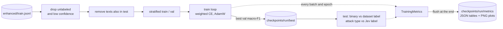
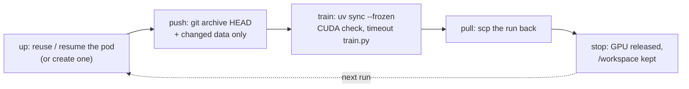

# Training

_Last updated: 2026-11-26_

`model/train/train.py` fine-tunes mmBERT on the enhanced data and evaluates the best epoch on the test split. All metric computation, tracking and plotting live in `model/train/metrics.py`; `train.py` only calls it. The model itself is described in [`ARCHITECTURE.md`](ARCHITECTURE.md); the data comes from [`ENHANCEMENT_PIPELINE.md`](ENHANCEMENT_PIPELINE.md). Results of the first full run are in [`METRICS.md`](METRICS.md).

> 🧪 **Next training batch: data augmentation.** A data-augmentation pipeline will create a new batch in which prompt injections are **inserted into benign text in different ways** (start, middle or end of a document; wrapped in emails, code, markdown or tool output; split across sentences; mixed with benign instructions). The library scores input chunk by chunk ([`ARCHITECTURE.md`](ARCHITECTURE.md#inference-in-the-library-chunking)), so the model needs to learn to spot an injection inside a chunk, not only a standalone attack prompt. Not built yet; the current run trains on the dataset rows as they are.



## Data rules

- Rows with `attack_type = unlabeled`, or an attack-type confidence below `--min-confidence` (0.6), are dropped. `other_injection` rows are **kept**: the pipeline flags them `needs_review` only because the class is a catch-all.
- Train texts that also appear in test are removed (exact match after whitespace normalization; near-duplicates are not detected).
- Validation is a stratified slice of train (`--val-fraction`, 5%). With no `test.jsonl`, a slice of train (`--test-fraction`, 10%) is held out as test.
- `test.jsonl` is touched only for the final evaluation.

## Loop

Plain PyTorch: AdamW (no weight decay on bias and norm parameters), linear warmup and decay, weighted cross-entropy (`--class-weights sqrt_inverse`, the square root of balanced weights; `none` to disable), gradient accumulation, gradient clipping, bf16 autocast on CUDA, dynamic padding. Device is chosen automatically: cuda, then mps, then cpu. The best epoch is chosen by validation macro-F1 over attack types, saved on each improvement, and reloaded from disk before testing.

Defaults (3 epochs, batch 16, lr 3e-5, max length 512) are common starting points and have not been tuned.

`--gradient-checkpointing` recomputes activations in the backward pass: less GPU memory, slower steps. Memory scales with batch size × max length, so with less memory lower `--batch-size` and raise `--grad-accum` to keep the same effective batch. Locally on MPS, batch 16 at 512 tokens ran out of memory on the first training batch (2026-11-21 run); that is why training moved to RunPod (below).

## Console output and logs

- **Progress bars (tqdm):** one bar per epoch with batches per second, running loss, running accuracy and the current learning rate, plus a bar for each validation pass and for the test pass. They disappear when done, so the terminal keeps only the log lines. `--no-progress` turns them off (use it when output goes to a file or CI). Log lines are routed through tqdm, so they do not break a running bar.
- **Logging (`havelai.train` logger):** to stderr, and to `<run>/train.log` with timestamps. It records:
  - the start: run name, the full config as JSON, data split sizes, class counts, class weights, device, torch and transformers versions, run directory;
  - **warnings**: classes with no or few training examples, an empty validation or test set;
  - progress: the untrained baseline, one line per epoch (losses, macro-F1, accuracy and its change), each new best checkpoint, the test results, the export;
  - **errors**: a missing input file, no usable rows, missing matplotlib, an interrupted run, and any exception with its full traceback.
- **A diverged run fails at once.** If the training loss becomes NaN or infinite, training stops with a `FloatingPointError` naming the epoch and batch, instead of training on NaN.
- **Failures and Ctrl+C still export.** The error (or the interruption, exit code 130) is logged, and the metrics measured so far are still written to `metrics/`.
- **No dataset text in logs.** Only settings, counts and errors are logged, so attack text never ends up in `train.log`. A test checks this.

The data report (the class table) is printed to stdout; everything else goes through the logger.

## Output

`model/train/checkpoints/<run>/` (gitignored):

- `best/`: model and tokenizer of the best epoch.
- `run.json`: config, class weights, class counts, device.
- `train.log`: the log described above.
- `metrics/`: everything below, written at the end by `TrainingMetrics.flush()`.

## Metrics (`model/train/metrics.py`)

One class, `TrainingMetrics`, holds the metric math, records what happens during training, and exports it. `train.py` creates one, passes it to the training loop, and calls `flush(run_dir / "metrics")` at the end. If training is interrupted or fails, whatever was measured so far is still exported.

```python
metrics = TrainingMetrics()
metrics.log_baseline(val_loss, golds, preds)       # validation pass before training: epoch 0
metrics.log_step(loss, correct, n)                 # every training batch
metrics.log_epoch(epoch, train_loss, val_loss, golds, preds)
metrics.set_test(golds, preds, is_injection)       # final evaluation of the best epoch
metrics.flush(out_dir)                             # JSON tables first, then the plots
```

### What is measured

- **Headline: injection vs benign**, with a prediction counted as injection when it is not `benign`, compared with the dataset's original `label`. This is the only ground truth in the data. Reported: accuracy, precision, recall, F1, false-positive rate and the confusion counts.
- **Attack type**: accuracy, macro-F1 (over classes that have test examples), per-class precision/recall/F1 and the confusion matrix. These compare with **Jev's labels**, so they measure agreement with the labeler, not true accuracy.
- **Improvement (the gradient of accuracy).** After every epoch the change in validation accuracy, macro-F1 and loss since the previous evaluation (`val_accuracy_delta`, `val_macro_f1_delta`, `val_loss_delta`). Epoch 1 is compared with the untrained model, evaluated once before training; that epoch-0 pass is never chosen as the best epoch. During training, the slope of training accuracy over batches, in accuracy points per 100 batches: the accuracy of each 50-batch window, then the least-squares slope over a sliding window of 7 such points. Above zero means the model is still learning; near zero means a plateau.

### Files in `metrics/`

| File | Content |
|---|---|
| `history.json` | the baseline, every epoch (losses, accuracy, macro-F1, the deltas), the windowed training curve with its slope. The table view of the first three plots. |
| `test_metrics.json` | the full test evaluation: per-class precision/recall/F1/support, confusion matrix, binary metrics. The table view of the last three plots. |
| `loss.png` | training and validation loss per epoch. Training loss is class-weighted and validation loss is not, so the two are not on one scale. |
| `accuracy.png` | validation accuracy and macro-F1 per epoch, with the best epoch marked. |
| `accuracy_gradient.png` | change in validation accuracy per epoch (blue: rose, red: fell), and, when there are enough batches, the training-accuracy slope. |
| `confusion_matrix.png` | attack-type confusion matrix on the test set, rows normalized, counts in the cells. |
| `per_class_f1.png` | precision, recall and F1 per class, with the number of test examples. |
| `binary_metrics.png` | injection-vs-benign counts and rates, including the false-positive rate. |

Plots are static light-surface PNGs (matplotlib, `Agg`; no display needed). A plot is skipped when its data is missing, for example the test plots when there is no test set. matplotlib is checked before training starts, so a missing install fails immediately instead of after a long run. The JSON files are written before the plots, so the numbers survive a plotting failure.

## Commands

```bash
uv run python -m model.train.train --dry-run                                             # data report, no torch
uv run python -m model.train.train --epochs 1 --limit-train 2000                          # quick trial
uv run python -m model.train.train                                                       # mmBERT-small, 3 epochs
uv run python -m model.train.train --no-progress                                         # no progress bars (CI, redirected output)
```

## Training on RunPod

`model/train/runpod_launch.py` runs `train.py` on a rented RunPod GPU pod, using the `runpod` SDK (2.4, in the `cloud` dependency group) plus `ssh`/`scp`. **The pod is kept between runs:** `run` stops it at the end (GPU released, files kept) instead of deleting it, and the next run resumes the same pod.



### What is kept, and where

A stop wipes the pod's container disk, so everything that should survive lives under `/workspace`:

| Path on the pod | Content |
|---|---|
| `/workspace/havelai/` | the code (replaced by `git archive HEAD` on every push), `run_train.sh`, `run.out`, `run.exit` |
| `/workspace/havelai-venv/` | the venv (`UV_PROJECT_ENVIRONMENT`); `uv sync` only changes what `uv.lock` changed |
| `/workspace/havelai-data/` | `train.jsonl`, `test.jsonl`; uploaded again only when their SHA-256 differs |
| `/workspace/havelai-runs/<run>/` | the checkpoints and metrics of each run (`train.py --out-dir`) |
| `/workspace/havelai-cache/` | uv, pip and Hugging Face download caches |

`/workspace` is a **pod volume** of `RUNPOD_VOLUME_GB` (default 30 GB), or the **network volume** when `RUNPOD_NETWORK_VOLUME_ID` is set:

- **Pod volume:** kept across stops, deleted by `down`.
- **Network volume:** outlives the pod, can be attached to a new pod, and pins pods to its data center (`RUNPOD_DATA_CENTER` is then required).

The first run on a pod downloads about 3.5 GB of packages, at whatever speed the host has: about 12 seconds on one pod and 15–20 minutes on another, measured 2026-11-25. On later runs the venv is already there, so `uv sync` should be close to a no-op; this has not been measured yet. `uv` itself is reinstalled on each run, because it lives on the container disk, but it comes from the pip cache.

### Which pod is used

1. `RUNPOD_POD_ID` in `.env`, if set;
2. otherwise the pod recorded in `gitignore/temp/runpod_pod.json` by the last `up`;
3. otherwise a new pod is created. Its id is printed with a hint to put it in `RUNPOD_POD_ID`.

A pod that is stopped (`EXITED`) is resumed. A pod id that no longer exists is an error: a second pod is never created silently. `push` refuses while a training job from an earlier `train` is still running on the pod.

**Resuming can fail.** A stopped pod restarts on the same host. If that host's GPU is taken, the pod does not come up and `up` gives up after 15 minutes. Then wait and retry, or `down` it and let the next `up` create a new pod.

### Setup

1. `uv sync --extra model --group cloud`.
2. In `.env` (see `example.env`): `RUNPOD_API_KEY`, and adjust the RUNPOD_* and TRAIN_* settings if you want. The API key is the only value you must fill in.
3. Nothing to do for SSH: with `RUNPOD_SSH_KEY` empty, the first `--yes` creates a passphrase-less ed25519 key in `gitignore/temp/runpod_ed25519` (mode 600, gitignored) that is used only for RunPod pods. Only the `.pub` is sent, as the pod's `PUBLIC_KEY`; nothing has to be added to your RunPod account. To use your own key instead, set `RUNPOD_SSH_KEY` to its path; that key is never generated or changed.
4. **Commit first.** Only `HEAD` is uploaded (`git archive`); uncommitted changes are not, and a warning says so.

### Settings (`.env`)

| Variable | Default | Meaning |
|---|---|---|
| `RUNPOD_POD_ID` | (none) | pod to reuse, resumed if stopped |
| `RUNPOD_GPU_TYPE` | `NVIDIA GeForce RTX 4090` | GPU type id, 24 GB |
| `RUNPOD_GPU_COUNT` | 1 | train.py uses one GPU |
| `RUNPOD_CLOUD_TYPE` | `SECURE` | `SECURE`, `COMMUNITY` or `ALL` |
| `RUNPOD_IMAGE` | `runpod/pytorch:1.0.2-cu1281-torch280-ubuntu2404` | must be a pinned tag. torch comes from `uv.lock`, not from the image |
| `RUNPOD_CONTAINER_DISK_GB` | 20 | wiped on every stop; only the OS and uv |
| `RUNPOD_VOLUME_GB` | 30 | pod volume at `/workspace`, kept across stops (ignored with a network volume) |
| `RUNPOD_MIN_RAM_GB`, `RUNPOD_MIN_VCPU` | 16, 4 | **placement minimums per GPU, not caps**: RunPod picks a host with at least this much |
| `RUNPOD_ALLOWED_CUDA` | `13.0,13.1,13.2` | host CUDA versions to accept; torch 2.15 from PyPI ships CUDA 13 libraries. Empty: no filter |
| `RUNPOD_DATA_CENTER` | (any) | optional, for example `EU-RO-1`. Required with a network volume |
| `RUNPOD_NETWORK_VOLUME_ID` | (none) | use this network volume as `/workspace` instead of a pod volume |
| `RUNPOD_MAX_HOURS` | 6 | train.py gets SIGINT after this (it exports its partial metrics), and is killed 5 minutes later |
| `RUNPOD_MAX_HOURLY_USD` | 1.00 | a new pod with a higher rate is terminated; a reused one is stopped |
| `RUNPOD_SSH_KEY` | (empty: `gitignore/temp/runpod_ed25519`, created on the first `--yes`) | private key for SSH |
| `TRAIN_BATCH_SIZE`, `TRAIN_EVAL_BATCH_SIZE`, `TRAIN_GRAD_ACCUM`, `TRAIN_MAX_LENGTH` | 16, 32, 1, 512 | passed to train.py as flags |
| `TRAIN_GRADIENT_CHECKPOINTING` | 0 | 1 passes `--gradient-checkpointing` |
| `PYTORCH_CUDA_ALLOC_CONF` | `expandable_segments:True` | set on the pod, reduces CUDA memory fragmentation |

Memory is bounded by the GPU you pick (its VRAM) and the TRAIN_* settings. RunPod has no hard cap on host RAM; the minimums only filter hosts.

### Commands

```bash
uv run python -m model.train.runpod_launch up                    # dry run: which pod, or the create request
uv run python -m model.train.runpod_launch run                   # dry run: also the script run on the pod
uv run python -m model.train.runpod_launch run --yes -- --epochs 1 --limit-train 2000   # smoke test
uv run python -m model.train.runpod_launch run --yes             # full run, default 3 epochs
uv run python -m model.train.runpod_launch run --yes --terminate # delete the pod at the end instead

# step by step (you must `stop` or `down` yourself)
uv run python -m model.train.runpod_launch up --yes              # reuse / resume / create
uv run python -m model.train.runpod_launch push
uv run python -m model.train.runpod_launch train -- --epochs 3   # detached; args after -- go to train.py
uv run python -m model.train.runpod_launch status                # pod status, rate, run finished or not
uv run python -m model.train.runpod_launch logs -n 50
uv run python -m model.train.runpod_launch pull                  # -> model/train/checkpoints/<run>/
uv run python -m model.train.runpod_launch stop                  # release the GPU, keep the pod
uv run python -m model.train.runpod_launch down                  # delete the pod and its pod volume
```

`run` = `up` → `push` → `train` → poll every minute → `pull` → `stop`. The stop happens in a `finally`, so an error or Ctrl+C also ends GPU billing. When training started, the results are pulled first. The pod's console output is saved as `<run>/pod_run.out`. The pod id, host and port are kept in `gitignore/temp/runpod_pod.json`, and the pod's SSH host key in `gitignore/temp/runpod_known_hosts`.

Exit codes in the pod's `run.exit`: 0 success, 124 `RUNPOD_MAX_HOURS` reached, 3 no usable CUDA on the pod (the driver does not match the locked torch), 130 interrupted; others come from `uv sync` or train.py.

### Costs and limits

- Nothing is created or resumed without `--yes`. The hourly rate (`cost` from the API) is printed when the pod is up.
- **A stopped pod is not free.** It no longer pays for the GPU, but its volume is still billed until `down`. A network volume is billed until you delete it in the console.
- **Step-by-step use bills the GPU until `stop` or `down`.** When `RUNPOD_MAX_HOURS` stops training, the pod itself keeps running.
- **`run` needs this machine awake and online.** Polling tolerates up to 10 failed SSH checks in a row (about 10 minutes); after that `run` gives up and stops the pod. If this machine sleeps, nothing runs, and the pod bills until it wakes. If the network is down, the stop call can fail too: then run `stop` yourself.
- `status` shows the recorded pod and its state. In doubt, check the RunPod console.

## Tested and not tested

The full path (build, train, validate, save, reload, test, export metrics and plots) runs offline on a tiny random BERT with synthetic data, and the loop learns a toy task in the unit tests. The plots were rendered from synthetic numbers and checked by eye; they have not been seen with real results. The end-to-end test runs `main()` on a tiny local checkpoint (success, a failing run, an interrupted run, missing matplotlib). It has since been run once for real: mmBERT-small, the full enhanced data, on a RunPod RTX 4090 (CUDA), 3 epochs of about 12.5 minutes each (run `mmBERT-small-runpod-20261125T190715Z`, results in [`METRICS.md`](METRICS.md)). It has not been run on MPS. `--gradient-checkpointing` is tested end to end on the tiny model.

The RunPod launcher is tested offline with a fake SDK and a fake ssh/scp runner: request contents, the SSH endpoint lookup, quoting in the pod script, the hourly-rate guard, and termination when a step fails. The pod script passes `bash -n`. It has been run against RunPod for the 2026-11-25 training run.
